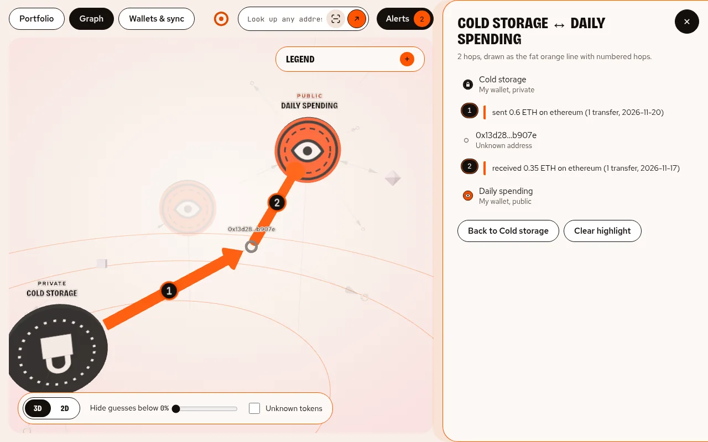
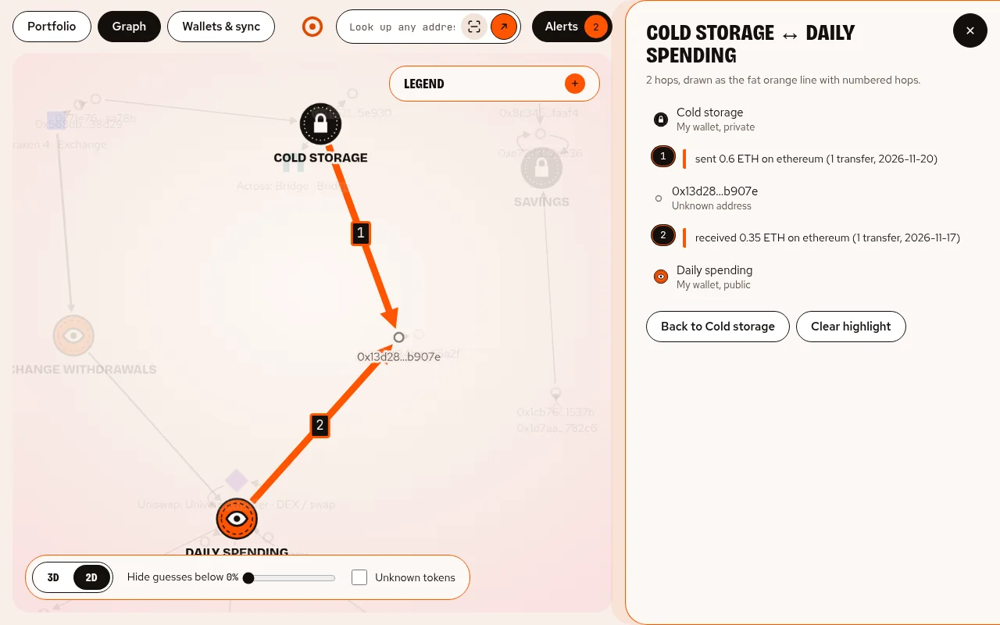

# Crypto tracker

Self-hosted view of everything you hold, and of what ties your wallets together. You
list the wallets that are yours and mark as **public** the ones tied to your identity
(withdrawals from a KYC exchange, addresses you gave to people). The app then shows:

- **Portfolio**: every asset across all wallets and chains, split into private and public.
- **A verdict per wallet**: either the other wallets of yours it can be tied to, directly
  or through strangers, bridges, common inputs or a chain of your own wallets, with hop
  count and confidence; or "no link found", next to the list of what that check cannot
  rule out. It never says "safe".
- **Funds origin**: where each wallet's money came from, followed back to a labelled
  source (exchange, bridge, mixer...), one of your wallets, or the edge of what is known.
- **A 3D graph** of your wallets, their counterparties (labelled by type) and the links
  between them. Any link or origin opens as a highlighted path with each hop spelled
  out. A flat 2D graph is the default on phones and where WebGL is missing.

- **Fiat values** for the whole portfolio, each wallet and each asset, and a value history
  that grows with every sync.
- **Alerts** when a verdict gets worse: a new link between two wallets, or a stronger one.

- **Lookup of any address**, yours or not: paste, type or scan it in the box at the top of
  every view. See [Look up an address](#look-up-an-address).

A wallet is a single address or an HD wallet: paste an xpub, ypub, zpub or output
descriptor and all its used addresses are found and treated as one wallet.

One web app, installable on a phone as a PWA.

## Screenshots

All taken from a demo instance with invented wallets and addresses.

| | |
|---|---|
|  |  |
| **Verdict** for one wallet: what it can be tied to, how strongly, and what the check could not cover. | **3D graph**: the path between a private and a public wallet, numbered hop by hop. |
|  |  |
| **2D graph**: the same path, flat. The default on phones. | **Lookup** of any address: what it holds and how it connects to your wallets. |


**On a phone**: the portfolio, split into private and public.

## Chains

| Chain | Works without a key | How deep it is read |
|---|---|---|
| Bitcoin, Litecoin | yes | Full: history, common-input and change heuristics, counterparties expanded. HD wallets on Bitcoin. |
| Bitcoin Cash | yes | Same heuristics; the 100 newest transactions per address. |
| Dogecoin | yes | Same heuristics; the 50 newest transactions. The free indexer allows about 100 lookups an hour: when that is used up the sync moves on, and the remaining addresses are read on a later sync. |
| Ethereum, Avalanche C | yes | Native coin and ERC-20 transfers, counterparties expanded. |
| Base, Arbitrum, Optimism, Polygon, BNB Chain | **needs `CT_ETHERSCAN_KEY`** | Same as Ethereum once the key is set. One free Etherscan key covers them. |
| Tron | yes | TRX and TRC-20 transfers, the 200 newest; counterparties not expanded automatically. |
| Solana | yes | SOL and SPL tokens, the 25 newest transactions, read as net balance changes; counterparties not expanded automatically. |

The same EVM address is read on every EVM chain. Chains that are read less deeply say so
in each wallet's verdict, and chains waiting for a key are listed as such instead of
failing.

## Run

```sh
uv sync
uv run python -m tracker          # http://127.0.0.1:8000
```

Under "Wallets & sync" add your wallets, tick "Also download open label sets" the first time (about 500,000
labels, takes a minute), and press Sync.

### Install on a server

On a Debian 12 or 13 host, from a copy of this repository:

```sh
sudo ./install.sh
```

It installs what is missing (Python, uv, the dependencies), creates the unprivileged
user `crypto-tracker` and a systemd service that starts on boot and restarts on failure,
and listens on port 8000 behind a generated password. The password is printed once, at
the end, with the URL and the commands for logs, stopping and uninstalling.

| Path | What |
|---|---|
| `/opt/crypto-tracker` | Code and dependencies, replaced on every run. |
| `/var/lib/crypto-tracker` | The database: wallets, labels, history. |
| `/etc/crypto-tracker/env` | The password and the variables of the table below, readable by root only. Restart after a change: `systemctl restart crypto-tracker`. |

To update, get the new code (`git pull`) and run the same command again. The database,
the password and the settings are kept.

The phone camera (see [Scanning a QR code](#scanning-a-qr-code)) needs HTTPS, which the
script does not set up. Put a reverse proxy with a certificate in front. With
[Caddy](https://caddyserver.com) and a DNS name that points at the host, this
`/etc/caddy/Caddyfile` is all of it, certificate included:

```
tracker.example.org {
    reverse_proxy 127.0.0.1:8000
}
```

Then set `CT_HOST=127.0.0.1` in `/etc/crypto-tracker/env` so that only the proxy reaches
the app, and restart it. Keep the password.

### Docker

With Docker (the image is not exercised by the test suite):

```sh
docker build -t crypto-tracker .
docker run -p 8000:8000 -v tracker-data:/data -e CT_PASSWORD=change-me crypto-tracker
```

| Variable | Default | Meaning |
|---|---|---|
| `CT_HOST`, `CT_PORT` | `127.0.0.1`, `8000` | Listen address. Anything but loopback requires `CT_PASSWORD`; without a password the app only answers to `localhost`/`127.0.0.1`. |
| `CT_PASSWORD` | unset | HTTP Basic password (any user name). Put TLS in front of it. |
| `CT_DB` | `tracker.db` | SQLite file. |
| `CT_ESPLORA` | `https://blockstream.info/api` | Bitcoin indexer (Esplora API: Blockstream, mempool.space, your own). |
| `CT_ETHERSCAN_KEY` | unset | Free Etherscan API key; turns on Base, Arbitrum, Optimism, Polygon and BNB Chain. Set it in the environment, never in a file you commit. |
| `CT_CHAINS` | unset | JSON file that adds EVM chains or points built-in ones at your own indexer, see `chains.example.json`. Keep the real file as `chains.json` (git-ignored). |
| `CT_LITECOIN`, `CT_BITCOINCASH`, `CT_DOGECOIN`, `CT_TRON`, `CT_SOLANA` | public APIs | Base URL of the indexer for that chain (Esplora, Haskoin, BlockCypher, TronGrid, Solana RPC). |
| `CT_DELAY` | `0.25` | Seconds between API calls. |
| `CT_SYNC_EVERY` | unset | Sync all wallets every this many minutes while the server runs. |
| `CT_SWAPS` | `on` | `off` never asks THORChain or Maya about your addresses. `CT_THORCHAIN` and `CT_MAYA` set their Midgard URLs. |
| `CT_CURRENCY` | `USD` | Currency of the values, e.g. `EUR` (ECB reference rate). |
| `CT_PRICES` | `on` | `off` never asks for prices. |
| `CT_BTC_PAGES`, `CT_EVM_ROWS` | `8`, `1000` | History loaded per address (pages of 25 / rows per list). |

## Android

The web app installs from Chrome's menu ("Add to Home screen") when your server has HTTPS
with a certificate the phone trusts. For a server on the LAN over plain http, or with a
self-signed certificate, there is a small Android app instead. It is only a frame around
the same pages: it asks where your server is and shows it.

Install:

1. Copy `crypto-tracker.apk` to the phone (Android 10 or newer) and open it. Android asks
   once to allow installing from that source.
2. Type the server's address, for example `192.168.1.20:8000` or `https://tracker.example`.
   - **Plain http** only works after ticking its box. Nothing is encrypted then: anyone on
     the same network can read your wallets and the password.
   - **Self-signed certificate**: tick its box. On first contact the app shows the
     certificate's SHA-256 fingerprint; accept only if it equals the one on your server
     (`openssl x509 -in cert.pem -noout -fingerprint -sha256`). The app then accepts that
     certificate and no other.
3. Enter the server's password when asked. It is remembered on the phone.

To change the server later, or to forget the password and certificate, long-press the app
icon and choose "Server settings".

The QR scanner uses the camera live over https (also self-signed, once accepted). Over
plain http a page is not allowed a live camera, so the scanner's "Take a photo" is used.

Build it yourself with the Android SDK and a JDK, no Gradle:

```sh
keytool -genkeypair -keystore release.jks -alias crypto-tracker -keyalg RSA -keysize 3072 -validity 10950
ANDROID_HOME=~/Android/Sdk ANDROID_KEYSTORE=release.jks ANDROID_KEYSTORE_PASS=... android/build.sh
```

An update only installs over the old app when it is signed with the same key, so keep the
keystore. The app has not been run on a real phone yet.

## Look up an address

The box at the top takes an address or a payment URI (`bitcoin:`, `litecoin:`,
`dogecoin:`, `bitcoincash:`, `tron:`, `solana:`, `ethereum:0x...@chainId`); amounts and
other parameters are dropped. The chain follows from the format. Only an EVM address
needs a question, because it exists on every EVM chain: you pick the chains to read,
unless the URI names one.

The view shows what the address holds per chain, with values, and who it deals with:
your own wallets first, then its counterparties with their labels, drawn around it in the
graph. Tokens the price source does not know well are left out, with their transfers.

A lookup is read-only. The address is fetched live and nothing about it is stored, so it
is not treated as yours and no verdict or alert changes. From the view you can:

- **Track as mine**: adds it to your wallets, private by default, and syncs it.
- **Watch**: keeps it in a list under "Wallets & sync". Still not yours, still in no verdict.

Like a sync, a lookup sends the address to the indexer of its chain.

### Scanning a QR code

The scan button opens the camera and reads the code of a wallet. Browsers only give a
page the camera in a secure context, so the live camera needs one of:

- the app opened as `http://localhost:8000` or `http://127.0.0.1:8000` on the same machine;
- HTTPS: a reverse proxy with a certificate the phone trusts in front of the app (Caddy,
  nginx, Traefik; a Tailscale or Let's Encrypt certificate works, a self-signed one only
  once it is trusted on the phone). Set `CT_PASSWORD`, as for any non-loopback use.

Over plain HTTP the scan button still works through **Take a photo**: the phone's own
camera app takes the picture and the code is read from it. Pasting always works.
Codes are decoded in the browser: by its built-in detector where there is one, otherwise
by the bundled [jsQR](https://github.com/cozmo/jsQR) (Apache-2.0), which is what iOS uses.

## Privacy

The database says which wallets are yours. Keep it on your machine.

Every address you sync is sent to the indexer that answers for it, so that indexer sees
your wallets together, from one IP address. That is exactly the link this app helps you
avoid. For real privacy point `CT_ESPLORA` and `CT_CHAINS` at indexers you run
(electrs/mempool for Bitcoin, Blockscout for EVM), or at least reach the public ones
through Tor or a VPN.

HD wallets: the xpub or descriptor is stored in the database and never sent anywhere,
and private keys are refused. But each derived address is looked up at the indexer, which
therefore learns that they belong together. With a public indexer, an HD wallet is only
as private as that indexer is discreet.

Swaps: each of your addresses is also looked up at the THORChain and Maya Midgard APIs.
`CT_SWAPS=off` turns that off.

Prices: only asset identifiers (coin names, token contracts) go to the price API, never
addresses or amounts.

## Data sources

- Bitcoin and Litecoin: any Esplora API (blockstream.info, litecoinspace.org). No key.
- Bitcoin Cash: Haskoin. Dogecoin: BlockCypher. Tron: TronGrid. Solana: the public RPC.
  All without a key, all rate-limited.
- EVM: Routescan for Ethereum and Avalanche without a key; Etherscan v2 for the other
  built-in chains with `CT_ETHERSCAN_KEY`; or any Etherscan-compatible API through
  `CT_CHAINS`. Public Blockscout instances allow only a handful of calls without a key.
- Prices: [DefiLlama](https://defillama.com/docs/api) coin prices, no key, cached for
  10 minutes; exchange rate from the ECB via frankfurter.app.
- Labels: [etherscan-labels](https://github.com/brianleect/etherscan-labels) (EVM, MIT, a
  2023 snapshot) and [GraphSense TagPacks](https://github.com/graphsense/graphsense-tagpacks)
  (Bitcoin and Ethereum, MIT). They are downloaded on request, not shipped. Labels you set
  by hand in the UI always win.

## What is a fact and what is a guess

Solid arrows are transfers read from the chain. Dashed lines are guesses that two
addresses share an owner; each carries a confidence, shown on the line. The numbers live
in `tracker/heuristics.py` and `tracker/graph.py`.

| Guess | Confidence | Rule |
|---|---|---|
| common-input | 0.9 | Two addresses are inputs of one Bitcoin transaction. |
| common-input, CoinJoin | 0.2 | Same, but the transaction has 3+ inputs and 3+ equal outputs. |
| change | 0.5 to 0.75 | In a 2-output payment, the output that matches the input script type (0.6), or is the non-round one (0.5); 0.75 when both rules agree, nothing when they disagree. |
| bridge | 0.5 to 0.95 | Money leaves one of your wallets on chain X and the same asset reaches another of your wallets on chain Y within 6 hours, 0 to 3% smaller. +0.25 if a labelled bridge is involved, +0.15 if within 0.5%, +0.1 if within 10 minutes; divided by the number of equally plausible matches. |
| exchange-flow | 0.09 to 0.8 | Money leaves one wallet into an exchange and the same asset, 0 to 2% less, comes out of an exchange into another wallet within 48 hours. Starts at 0.5 (same exchange), 0.3 (two exchanges) or 0.15 (the deposit went to an address that was never expanded); +0.15 within 0.5%, +0.1 within an hour; x0.6 for round amounts; divided by the number of equally plausible matches. Repeated matches between the same two wallets are not independent proof: they lift the best single match at most halfway to 0.8, never past it. |
| swap | 0.95 | THORChain or Maya Protocol recorded a swap from one address to the other (for example ETH in, BTC out). The record is public and names the destination, so this is close to a fact. |

Several transactions supporting the same guess combine as `1 - (1-c1)(1-c2)...`.

A link between two wallets multiplies the confidences along its path (a transfer counts
1.0) and then by 0.7 for every stranger it passes through. Links chain through your own
wallets: public A tied to private B tied to private C exposes C. Paths never pass through
a labelled service or a very active address: two people using Binance are not linked
on-chain. Such shared services are still listed in the verdict, because the service
itself can link you.

Funds origin is an estimate of the mix, not a coin trace: an address that forwards money
passes on its own sources in proportion to what it received of that asset, ignoring
timing. It stops at a label, at one of your wallets, at an address that was not expanded,
or at the hop limit, and says which.

## Known limits

- Swaps that change the asset are matched only through THORChain and Maya Protocol,
  whose records are public. Other swap services and instant exchangers are not.
- A bridge or exchange flow is only matched when both ends are wallets you declared.
- Mixers are not correlated by amount: their fixed denominations make it meaningless.
- HD wallets are Bitcoin only (no Ltub, dgub or EVM account keys yet). A plain xpub is scanned as four address types (legacy,
  wrapped segwit, segwit, taproot), about 160 lookups when empty; a zpub, ypub or
  descriptor scans only its own.
- The value history starts with the first sync; it is not reconstructed from the past.
  Assets without a known price are listed but left out of the totals.
- XRP, TON, Cardano, Cosmos and Monero are not supported.
- Litecoin's old script addresses starting with 3 are read as Bitcoin; use the M form.
- On Solana a token's symbol comes from the price source; tokens it does not know show
  as the first characters of their mint address.
- A token that only borrows a known name (a fake USDC) is listed apart, unpriced.
- Very active addresses load only their newest history and are flagged in the UI.
- Token balances come from the transfer history unless the indexer has a token-balance
  call (`"tokenlist": true`), so rebasing tokens are off.
- Address checksums are verified, except the mixed-case form of EVM addresses and
  Bitcoin Cash's cashaddr.
- An unlabelled exchange wallet looks like a stranger and can produce a false link;
  label it in the UI and the link disappears.

## Develop

```sh
uv run pytest
uv run ruff check . && uv run ruff format --check .
```

three.js 0.187.0 and Cytoscape.js 3.35.0 (both MIT) are vendored unmodified in
`tracker/static/vendor/`, loaded as plain ES modules: no build step, nothing from the internet.
